# Advanced Search

This form brings great search capabilities to TQVault.
It can not only help find items but also theory craft.

Open it with the "Search" button of the navigation bar or with <kbd>CTRL</kbd>+<kbd>F</kbd>.

_**This tool is meant to be used with the "Pre-Load All Vault And Character Files" setting enabled.**_

_**The first load can be long but reopening the form si fast.**_

---

## Table of contents
+ [Fulltext search](#Fulltext)
+ [Regex search](#Regex)
+ [Category visibility](#ShowHide)
+ [Category filtering](#CategoryFilter)
+ [Uncheck all](#UncheckAll)
+ [Display match during selection](#DispMatch)
+ [Reduce categories during selection](#Reduce)
+ [Logical operator](#AndOr)
+ [Requirement filters](#ReqFilters)
+ [Quick filters](#QuickFilters)
+ [Query persistance](#Query)
+ [Flexible visibility](#Flexible)
+ [Preview tooltip](#Preview)
+ [Category tooltip](#CategoryPreview)
+ [Find an item's copies](#FindCopies)
+ [Move the results](#MoveResults)

---

## UI
Here's a brief overview of some UI features.

---

### Fulltext search
By default, the input is a literal search.

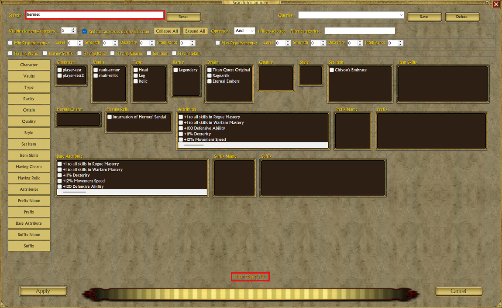

---

### Regex search

By using `/` as first char everything else is a standard [C# regular expression](https://docs.microsoft.com/en-us/dotnet/standard/base-types/regular-expression-language-quick-reference).

Here's few examples.

- `/rune|earth` : Everything with "rune" or "earth"
- `/chance of .+%.+bleeding damage` : All chance of + percent bleeding damage
- `/\+.+%.+(life|mana) leech` : Any + percentage of life or mana leech
- `/\+.+%.+(cold|fire) damage` : Any + percentage of cold or fire damage

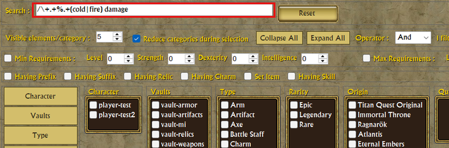

---

### Category visibility
Some categories may have no interest to you.

You can hide it.

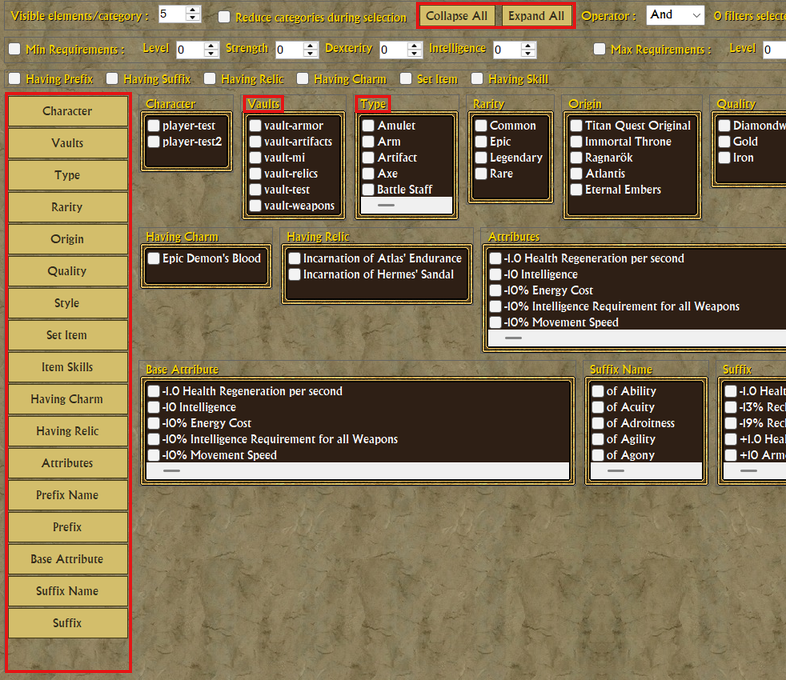

The screenshots of this page are older: the form now also has the "Origin", "Mod", "Sets" and "Item Skills" categories
and the "Having Skill" and "Modded" quick filters. "Mod" lists the mods the items come from (the mod whose data gave at
least one of the item's records, read with the data of its vault, character or shared stash), the installed mods first; "Modded" keeps every item from a mod.

---

### Category filtering
looking for specific categories?

It accept [regular expressions](#Regex).

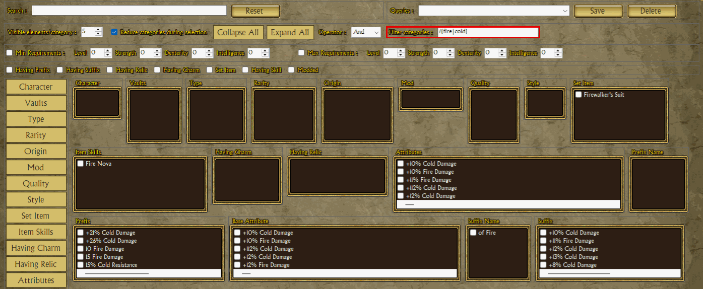

---

### Uncheck all
You can uncheck all selected attributes inside a category by 'right-clicking' the yellow category label.
A left click on the label collapses or expands the category.

---

### Display match during selection
The item count adjust in real time.

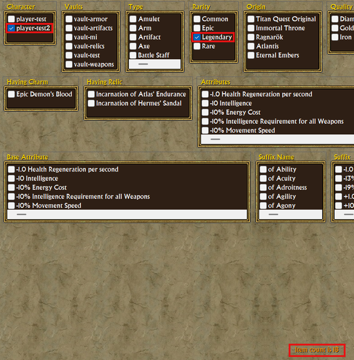

---

### Reduce categories during selection
When that checkbox is enabled, each selection reduce further available categories and items.

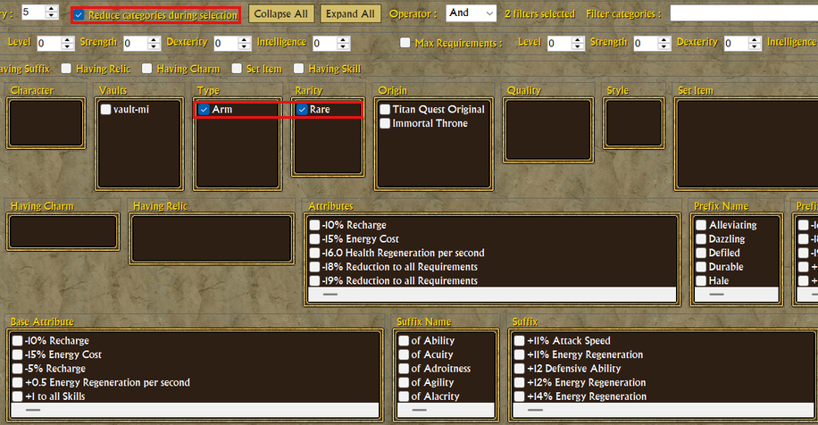

---

### Logical operator
This let you choose logical mode for item filtering.
- _**And**_ : Items must comply **to all** selected categories (Default). 
- _**Or**_ :  Items must comply **to at least one** selected categories .

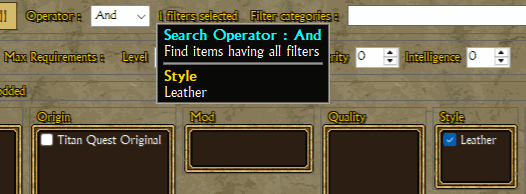

---

### Requirement filters
You can setup a requirement range.

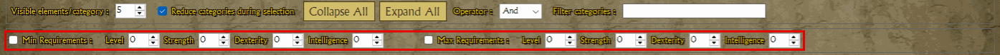

---

### Quick filters
You can narrow the results with these quick filters before being specific.

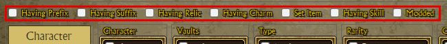

---

### Query persistance
You can save and reload a filter selection.
Don't loose time when you track something complex.

The save contains
- Search term,
- UI behaviors & visibility,
- Requirement filters,
- Quick filters,
- The checked elements of each category, the And/Or mode and the "Filter categories" text

The queries are kept in the `SearchQueries.json` file.

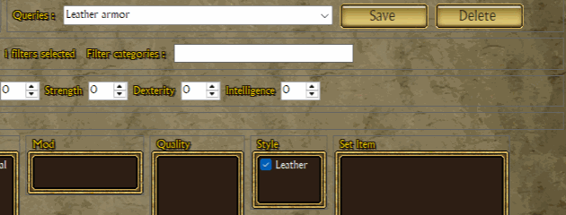

---

### Flexible visibility
You can adjust the number of visible elements per category, from 5 to 150.

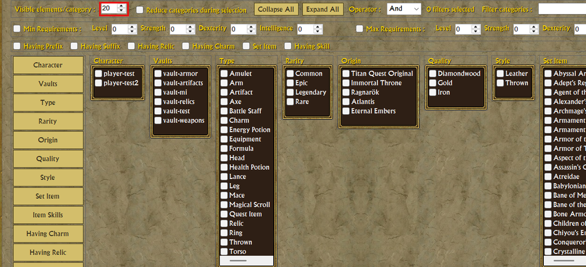

---

### Preview tooltip
Hovering on the item count in the bottom of the windows display a popup with a preview of found items.

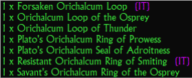

---

### Category preview
Hovering on a category display a tooltip with the number of related items.

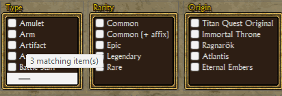

---

### Find an item's copies
Right-click an item, in any vault, bag, equipment or stash, and open its **Search** menu to list the items related to it
among every loaded item: all the vaults (not only the one shown), every character's equipment, bags and personal stash,
the transfer stash, the relic vault and the pieces stored in the [loadouts](LOADOUTS.md).

| Entry | Lists the items with |
|-------|----------------------|
| Copies with same seed | the same base item, prefix, suffix and seed: the same piece (socketed relics, charms and their bonus may differ) |
| All copies | the same base item, prefix and suffix, any seed |
| Same base | the same base item, whatever their affixes |
| Same prefix | the same prefix, whatever their base item (disabled for an item without a prefix) |
| Same suffix | the same suffix, whatever their base item (disabled for an item without a suffix) |

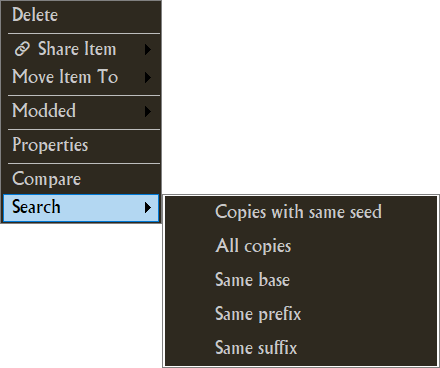

The results open in the search results window, its title naming the search and the number of items found. The item
clicked comes first, in bold and marked *(source)*; the others follow by container and place. Clicking a result shows it
like an Advanced Search result: a loadout piece selects its character and that loadout in the loadout bar.

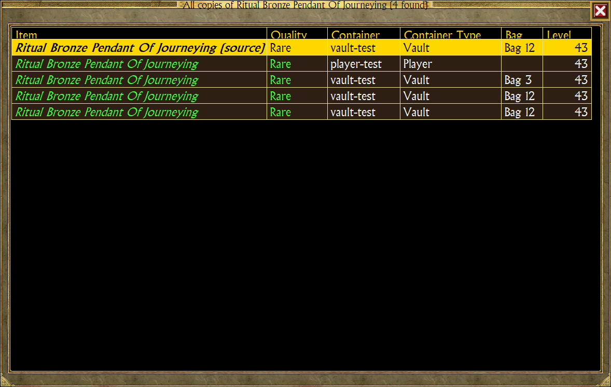

_**Like the Advanced Search, it finds the items of the files loaded: enable "Pre-Load All Vault And Character Files" to
search every vault and character.**_

### Move the results
The search results window, of the Advanced Search or of an item's **Search**, can move the items it lists. Select rows
with <kbd>CTRL</kbd> or <kbd>SHIFT</kbd> clicks, or all of them with **Select All** (or <kbd>CTRL</kbd>+<kbd>A</kbd>),
then pick a target in **Move To**, under the list or in the list's right-click menu:

| Target | Moves the selected items to |
|--------|-----------------------------|
| Transfer Stash | the transfer stash shown with the selected character (its map's, for a modded character) |
| Player Stash | the selected character's own stash (storage area) |
| Relic Vault | the relic vault shown with the selected character; available only when every selected item is one it takes (relics, charms, artifacts, formulae) |
| Vaults > *vault* > *bag* | that bag of any vault, read when its entry opens if no vault panel shows it |

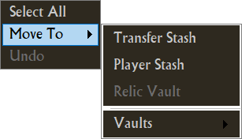

Each item takes the first free cells of the target, as **Move Item To** places one. Worn pieces and the pieces stored in
the [loadouts](LOADOUTS.md) move too: a worn piece leaves its slot empty, a loadout piece leaves its loadout slot empty
(the loadouts file is written at once, as every loadout change). The items that cannot move stay where they are, and the
line under the buttons tells which and why: no room left in the target, a read-only character, the equipment locked by
the *Player Equipment ReadOnly* setting, an item the relic vault does not take, or an item no longer where the search
found it. The rows then show where their items are, and the main window shows the new contents.

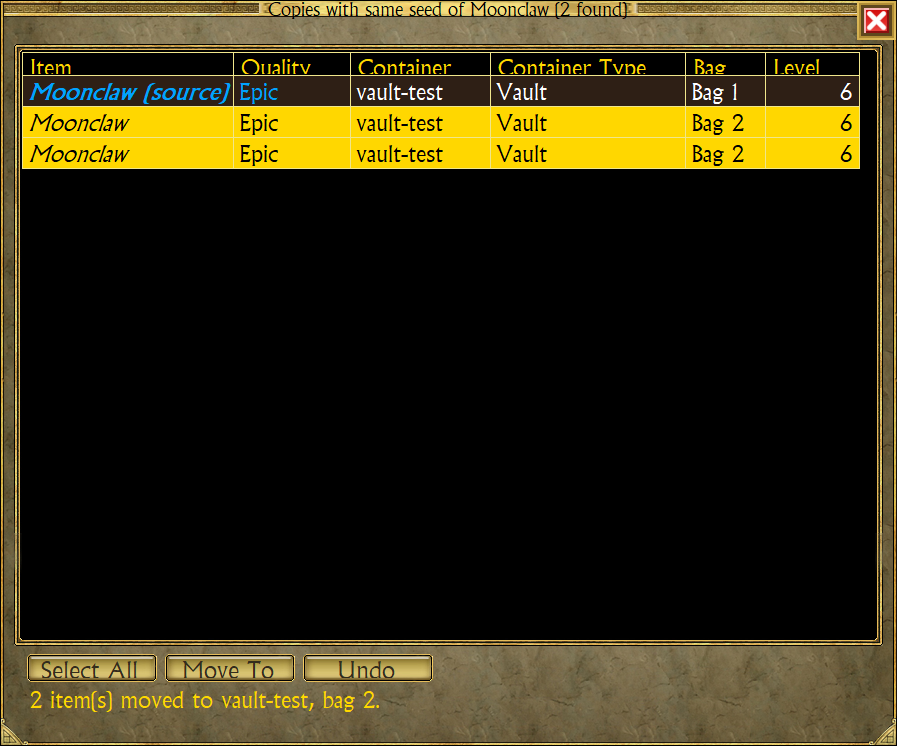

**Undo** puts the items of the last move back where they were: their cell, equipment slot or loadout slot. Each click
undoes one more move. An item moved again since, or whose place is taken, stays and is reported. The history belongs to
the window: closing it forgets it.

_**Moves are saved like any other change, with the Save button or when leaving TQVault.**_
