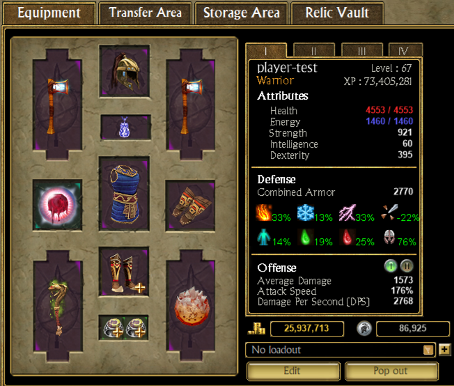
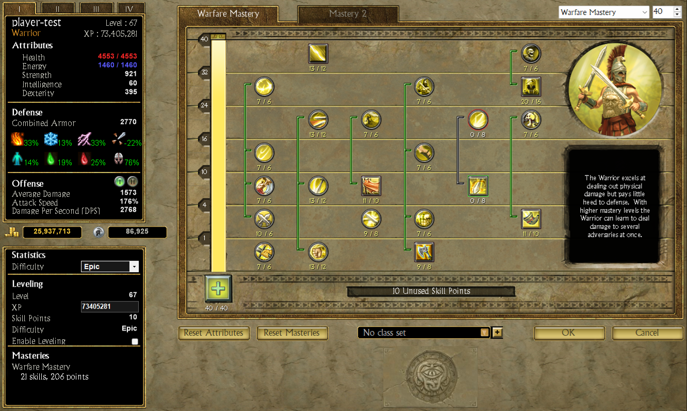
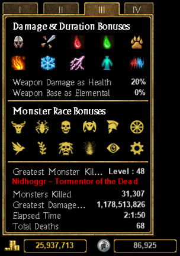
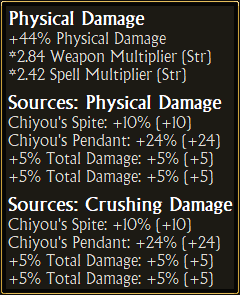
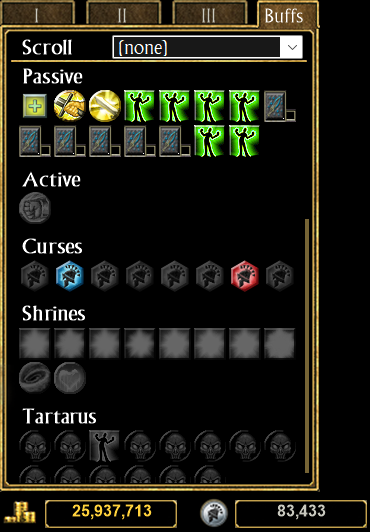

# Character editor

Edit a character's attributes, masteries and skills in a window drawn like the game's, and read the statistics of the
game's character window without starting the game.

> **Note:** a "character editing" feature. Enable it in the settings: tick **Allow Cheats**, then **Allow Character
> Editing Features**. Do not edit a character loaded in the game.

## In the main window

The **Equipment** tab shows the statistics panel next to the equipment, read only:

- Tabs **I**, **II** and **III**, the gold and the Electrum under them. Hover an icon or a value for details.
- It follows the equipment: equip or remove an item and the values change.
- Resistances for the highest difficulty unlocked, no buffs.
- Shown with or without character editing; only its **Edit** button, which opens the editor, needs the setting.

## Open it

Select a character, then click **Edit** under the statistics panel of the **Equipment** tab. The editor shows in place
of the main content.

- Nothing changes before **OK**; **Cancel** (or Escape) drops every change.
- **OK** changes the character loaded in TQVault; the file is written when TQVault saves, as any other change.

## The editor

- Left: the game's character window (tabs **I**, **II**, **III**), and under it the editing options: statistics,
  leveling, masteries.
- Right: one page per mastery. The statistics stay in sight and change at each click on a skill.

### Attributes

While attribute points are left, a `+` button shows next to each attribute. Once the last point is spent it goes away:
use **Undo** or **Reset Attributes** to get points back.

| Click on `+` | Effect |
|---|---|
| Left | Spends one point |
| Right | Takes one point back |
| Shift + left | Spends all the points |
| Shift + right | Back to the starting value |

- **Undo**: attributes as when the editor opened. The game's button, in place of the "Attributes" title once an
  attribute has changed.
- **Reset Attributes** (under the mastery pages): gives back every point spent since level 1.

### Leveling

Tick **Enable Leveling** to change the level and the unlocked difficulty.

- The XP is set to the level's first XP.
- A level change adds or removes its attribute and skill points.
- Hidden for a character never played in the game.

### Masteries

The list shows each mastery with its number of skills and points (the mastery counts as one skill). **Reset
Masteries** (under the mastery pages) removes both masteries and refunds their points.

## Statistics

Computed with the game's formulas from the attributes, equipped items, item sets and skills.

| Tab | Shows |
|---|---|
| I | Attributes, combined armor, main resistances, average damage, attack speed, DPS |
| II | Secondary resistances, offensive and defensive ability, chances to dodge, to avoid projectiles and to block, regeneration, energy cost and recharge reduction, casting and movement speed |
| III | Damage and duration bonuses, monster race bonuses, play statistics |
| Buffs | Every source of bonuses or maluses, each toggled on its own (see below) |

 

Hover an icon or a value for its details, as in the game. The rollovers also list the **sources** of a value: per
source its own bonus, then in parentheses what it changes in the value shown (the value without that source subtracted);
plain sums (pet and race bonuses, durations) list the bonuses only. Hovering Energy also tells the energy reserved
(temple curses, Tartarus) and by what.

Option under the statistics: **Difficulty**, the difficulty played; Epic and Legendary lower the resistances.

### Buffs tab

One section per kind of source; a click turns a source on or off (greyed when off) and the statistics follow. The
toggles are kept in memory only, never saved, back to their defaults for another character.

| Section | Sources | At the start |
|---|---|---|
| Equipment | Each equipped item and item set with bonuses (text rows) | On |
| Passive | Masteries, passive skills (a modifier with its skill), quest rewards, passive skills granted by items | On |
| Active | Auras and buffs of the skills or granted by items; a buff a potion triggers (Neidan), with its chance and duration | Off; on for a toggle an item casts when worn |
| Pets | Auras the pets of the summons cast on those around them (Battle Standard), and the ones a pet modifier adds | Off |
| Curses | The 8 temple curses ("Heracles' way") | Saved ones on |
| Shrines | World shrine buffs and quest blessings, the difficulty's variant | Off |
| Tartarus | Tartarus arena effects on the player | Off |
| Scroll | The buff of the scroll picked in the drop-down at the top | Off |

What a skill casts on monsters (an attack's freeze, an aura weakening nearby monsters) is never listed. The main
window's statistics panel has the same tab.

## Mastery pages

One page per mastery, laid out like the game's skill window, right of the statistics (picture above).

Choose the mastery and its level with the two boxes at the top right, or with the `+` button under the mastery bar
(same four clicks as a skill).

- An empty slot is a page named "Mastery 1" or "Mastery 2", "(None)" in the list: the skill window without a tree.
- A new mastery starts at level 1, so it needs one free skill point. The other page's mastery is refused.
- Changing or removing a mastery gives back all its points.
- Lowering the mastery level resets the skills of the tiers it closes.
- Changing the masteries clears the class saved; the game sets it again. Until then the class shown is the one the masteries make.

| Click on a skill | Effect |
|---|---|
| Left | +1 point |
| Right | -1 point |
| Shift + left | Highest level the points allow |
| Shift + right | Lowest level |

- The game's rules apply: a skill needs its mastery tier and the skill before it.
- Under a skill: `level / maximum`. The level includes equipment bonuses, so it can exceed the maximum.
- The bar at the bottom shows the unused skill points.

| Border | Meaning |
|---|---|
| Green | A point can be added |
| Gold | No point left |
| Blue | At its maximum |
| Gray | Mastery level too low |
| Red | Needs the skill before it |

Hover a skill for the game's tool tip, with the equipment's bonus:

