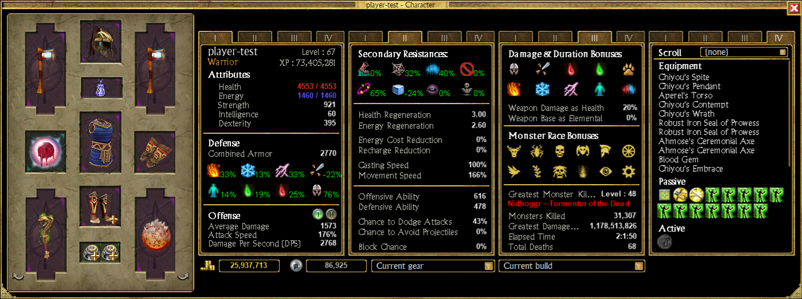
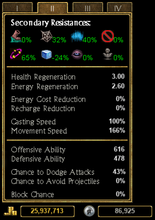
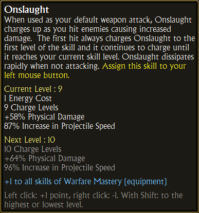

# Character editor

Edit a character's attributes, masteries and skills in a window drawn like the game's, and read the statistics of the
game's character window without starting the game.

> **Note:** a "character editing" feature. Enable it in the settings: tick **Allow Cheats**, then **Allow Character
> Editing Features**. Do not edit a character loaded in the game.

## In the main window

The **Equipment** tab shows the statistics panel next to the equipment, read only:

- Tabs **I**, **II** and **III**, the gold and the Electrum under them. Hover an icon or a value for details.
- It follows the equipment: equip or remove an item and the values change.
- Resistances for the highest difficulty unlocked, no buffs.
- Shown with or without character editing; only its **Edit** button, which opens the editor, needs the setting.
- **Pop out**, beside **Edit**, opens the character in a floating window (below).

## Floating window

**Pop out** shows the character's equipment with tabs **I** to **IV** side by side, so a buff toggled in tab IV changes
every number at once.

- One window per character; several characters at once. **Pop out** again brings the window to the front.
- Its buff toggles are its own, in memory only, as in tab IV.
- Drag items between the window and the main window (inventory, stash, vaults), with the usual rules: a read-only
  character or *Player read-only* refuses changes. TQVault's **Save** writes them.
- Item menu: **Compare** with any item of either window; **Move Item To** the vault shown or the transfer stash.
- The list right of the gold and the arrows on the stone show a loadout in place of the equipment, read-only, with its
  statistics. **Current gear** shows the equipment worn again.
- The list under tab III computes the statistics with a class set (below), applied to the save as the editor applies
  it; **Current build** is the save's. Memory only: nothing is written. A red mark tells a set that did not fit
  (too few points or mastery slots). It combines with a loadout. The red items (item requirements) follow the build
  shown.
- The main window and the window show each other's changes when they show the same character.
- Open windows reopen at the next start, where they were. They follow the zoom and the DPI of their monitor.

## Open it

Select a character, then click **Edit** under the statistics panel of the **Equipment** tab. The editor shows in place
of the main content.

- Nothing changes before **OK**; **Cancel** (or Escape) drops every change.
- **OK** changes the character loaded in TQVault; the file is written when TQVault saves, as any other change.

## The editor

- Left: the game's character window (tabs **I**, **II**, **III**), and under it the editing options: statistics,
  leveling, masteries.
- Right: one page per mastery. The statistics stay in sight and change at each click on a skill.
- It scales to fill the main window, maximized or not, whatever the zoom; edits are kept.

### Attributes

While attribute points are left, a `+` button shows next to each attribute. Once the last point is spent it goes away:
use **Undo** or **Reset Attributes** to get points back.

| Click on `+` | Effect |
|---|---|
| Left | Spends one point |
| Right | Takes one point back |
| Shift + left | Spends all the points |
| Shift + right | Back to the starting value |

- **Undo**: attributes as when the editor opened. The game's button, in place of the "Attributes" title once an
  attribute has changed.
- **Reset Attributes** (under the mastery pages): gives back every point spent since level 1.

### Leveling

Tick **Enable Leveling** to change the level and the unlocked difficulty.

- The XP is set to the level's first XP.
- A level change adds or removes its attribute and skill points.
- Hidden for a character never played in the game.

### Masteries

The list shows each mastery with its number of skills and points (the mastery counts as one skill). **Reset
Masteries** (under the mastery pages) removes both masteries and refunds their points.

### Class sets

A class set is a saved build of the character: its masteries with their skill points, and its attribute points. The
box under the mastery pages, between **Reset Masteries** and **OK**, lists the character's sets.

- Pick a set in the box: it is applied to the editor. **OK** applies it to the character (written at the next save),
  **Cancel** drops it.
- **[+]** or **Save as...**: a new set holding the build shown, under a name you type (unique per character, case
  ignored).
- Right click: **Save** (the build shown goes into the selected set, asks first), **Save as...**, **Rename**,
  **Delete** (the selected set, asks first).
- The selected set is the one applied or saved last. It is shown again at the next opening while the character keeps
  the same two masteries (slot order and points aside); otherwise no set is selected.
- A red mark in the box tells that the build shown differs from the selected set: points spent in the game since the
  set was saved, clicks in the editor, or a set applied in part. Its tool tip says which, and the points per mastery and attribute. **Save**
  keeps the new build in the set; picking the set goes back to it.
- Points a set does not spend stay to spend: a set without masteries leaves every skill and attribute point in the
  unspent points. The available points are the save's (unspent plus spent), whatever the level or the quests gave.
  Without enough points or mastery slots, the set is applied in part and a message says so.
- The sets and the set selected are written on **OK**, dropped by **Cancel**. File: `TQVaultAE.ClassSets.json` next
  to `Player.chr`; it follows the character like the [loadouts file](LOADOUTS.md#good-to-know).
- A read-only character's sets can be picked to try them, not changed.

## Statistics

Computed with the game's formulas from the attributes, equipped items, item sets and skills.

As in the game, a worn piece whose requirements are not met (level, strength, dexterity, intelligence, lowered by the
requirement reductions; the buffs on in tab IV count) stays in its slot, red, and counts for nothing: its bonuses, its item
set, the skills it grants or raises. A piece out of reach can still be put in a slot, red, as a warning.

An item's tool tip is written for the character, as in the game:
- **Requirements**: the base value when the character meets it; else the reduced value and the reduction,
  `Required Strength: 220 [ 424 - 48% Reduction]`, in red while still not met.
- **Item set**: the pieces the character wears in yellow, the others in grey, then the set bonus for that number of pieces.

| Tab | Shows |
|---|---|
| I | Attributes, combined armor, main resistances, average damage, attack speed, DPS |
| II | Secondary resistances, offensive and defensive ability, chances to dodge, to avoid projectiles and to block, regeneration, energy cost and recharge reduction, casting and movement speed |
| III | Damage and duration bonuses, monster race bonuses, play statistics |
| IV | Every source of bonuses or maluses, each toggled on its own (see below) |

 

Hover an icon or a value for its details, as in the game. The rollovers also list the **sources** of a value: per
source its own bonus, then in parentheses what it changes in the value shown (the value without that source subtracted);
plain sums (pet and race bonuses, durations) list the bonuses only. Hovering Energy also tells the energy reserved
(temple curses, Tartarus) and by what.

Option under the statistics: **Difficulty**, the difficulty played; Epic and Legendary lower the resistances.

### Weapon sets

The gems **I** and **II** right of *Offense* (tab I) pick the weapon set the statistics count; the lit one is counted.

- At the start, the set in hand in the save; the gem's tool tip names it.
- Click the other gem to see the statistics with that set: damage, attack speed, the weapons' and their relics' bonuses,
  skill levels they grant, the Buffs tab's equipment. The pieces don't move and the save doesn't change.
- Memory only, like the buff toggles: the main window's panel, the editor and each floating window keep their own
  choice; the main window's panel goes back to the save's set when the equipment changes, as its toggles do.
- The weapons of the set counted are checked for their requirements.

### Tab IV: buffs

One section per kind of source; a click turns a source on or off (greyed when off) and the statistics follow. The
toggles are kept in memory only, never saved, back to their defaults for another character.

| Section | Sources | At the start |
|---|---|---|
| Equipment | Each equipped item and item set with bonuses (text rows) | On |
| Passive | Masteries, passive skills (a modifier with its skill), quest rewards, passive skills granted by items | On |
| Active | Auras and buffs of the skills or granted by items; a buff a potion triggers (Neidan), with its chance and duration | Off; on for a toggle an item casts when worn |
| Pets | Auras the pets of the summons cast on those around them (Battle Standard), and the ones a pet modifier adds | Off |
| Curses | The 8 temple curses ("Heracles' way") | Saved ones on |
| Shrines | World shrine buffs and quest blessings, the difficulty's variant | Off |
| Tartarus | Tartarus arena effects on the player | Off |
| Scroll | The buff of the scroll picked in the drop-down at the top | Off |

What a skill casts on monsters (an attack's freeze, an aura weakening nearby monsters) is never listed. The main
window's statistics panel has the same tab.

## Mastery pages

One page per mastery, laid out like the game's skill window, right of the statistics (picture above).

Choose the mastery and its level with the two boxes at the top right, or with the `+` button under the mastery bar
(same four clicks as a skill).

- An empty slot is a page named "Mastery 1" or "Mastery 2", "(None)" in the list: the skill window without a tree.
- A new mastery starts at level 1, so it needs one free skill point. The other page's mastery is refused.
- Changing or removing a mastery gives back all its points.
- Lowering the mastery level resets the skills of the tiers it closes.
- Changing the masteries clears the class saved; the game sets it again. Until then the class shown is the one the masteries make.

| Click on a skill | Effect |
|---|---|
| Left | +1 point |
| Right | -1 point |
| Shift + left | Highest level the points allow |
| Shift + right | Lowest level |

- The game's rules apply: a skill needs its mastery tier and the skill before it.
- Under a skill: `level / maximum`. The level includes equipment bonuses, so it can exceed the maximum.
- The bar at the bottom shows the unused skill points.

| Border | Meaning |
|---|---|
| Green | A point can be added |
| Gold | No point left |
| Blue | At its maximum |
| Gray | Mastery level too low |
| Red | Needs the skill before it |

Hover a skill for the game's tool tip, with the equipment's bonus:

