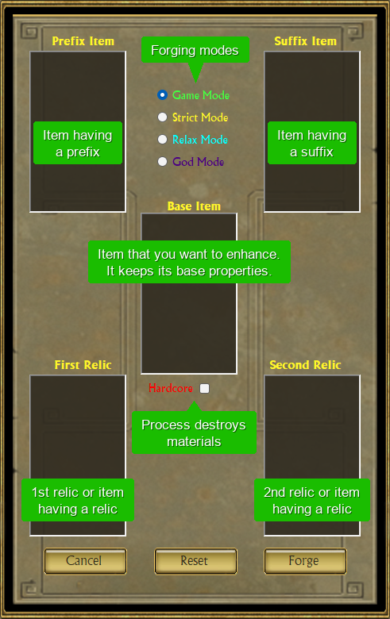
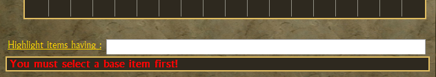
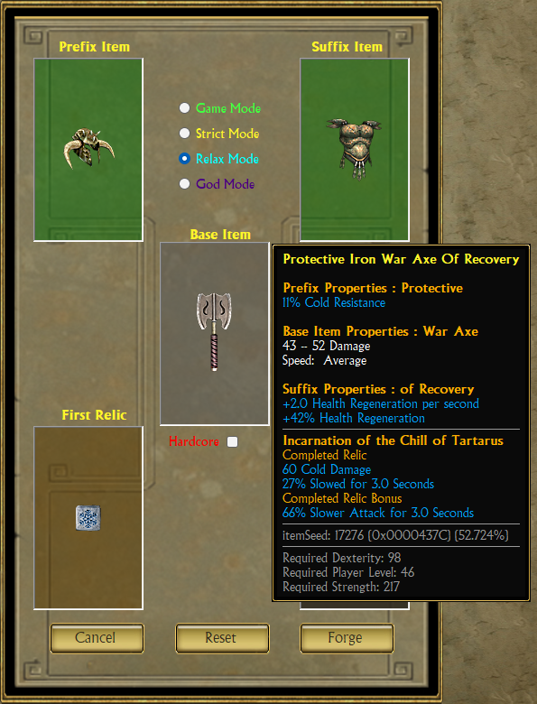
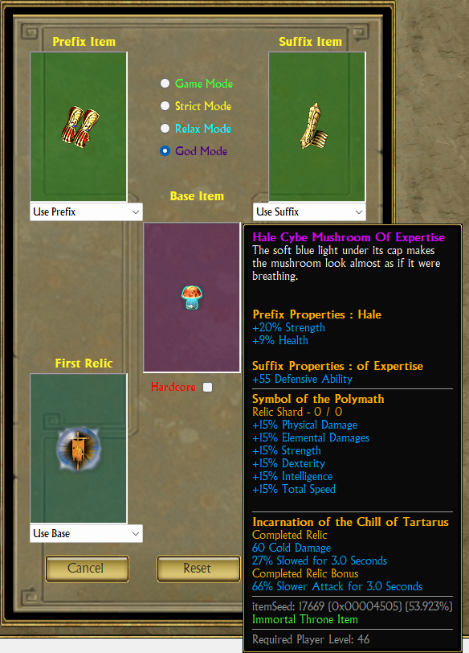

# Custom crafting system

Item crafting should have been in this game. 

TQVaultAE provide a dedicated crafting system that helps you create the item of your dream.

---

## Table of contents
* [Forge UI](#UI)
* [Notifications](#Notifications)
* [Tooltip Preview](#TooltipPreview)
* [Crafting Modes](#Modes)
    + [Game](#GameMode)
    + [Strict](#StrictMode)
    + [Relax](#RelaxMode)
    + [Hephaestus](#GodMode)
    + [Hardcore](#Hardcore)
* [Insert a relic or charm into an item](#Socket)

---

### The Forge UI
**_The Forge is an "Item Editing" feature and must be enable in the tool settings: tick "Allow Cheats", then "Allow Item Editing Features"._**

You can access the forge from TQVaultAE upper navigation bar. 
Once inside you can drag & drop items from your left vaults.
An item must come from a bag: one you just created and still hold is refused with "The item must be stored first!".

While the forge is open, it takes the place of the character, stash and second vault panels, the other buttons of the navigation bar
are hidden except "Exit", and the "Forge" button reads "Show Vault": it closes the forge like "Cancel" does.
The forge follows the screen DPI and the TQVault zoom, like the rest of the window.

_**Note:** The Forge doesn't move your objects, however, it changes the properties of the base item used._

The buttons under the slots:
+ **Forge** merges the materials into the base item. It needs a base item and at least one material, and a
  material from a mod must come from the base item's mod (base game parts go with any mod). <kbd>ENTER</kbd> or
  <kbd>SPACE</kbd> press it too ([shortcuts](SHORTCUTS.md)).
+ **Reset** empties all the slots and keeps the forge open.
+ **Cancel** closes the forge without changing anything.

Forging or cancelling, return TQVault UI in it's previous state.

Dropping another base item removes from the slots the materials that the current mode no longer accepts with it.

---

### Notifications
Some actions may be prohibited depending on the mode used.

The Forge will emit a failure sound and display a message in the TQVaultAE notification area.

---

### Tooltip Preview
During the forging process, the deposited items have their tooltip in detail 
mode and the tooltip of the base item displays the preview of the final result.

_**Note:** Here's an example of a white item getting stronger._

---

### Crafting Modes
Crafting modes allows you to play as you want.
 
Do you want some restrictions as the game would have probably put in place or the crazyness of an OP item that break the game ?

Rest the mouse on a mode to see a card listing what it allows and what it restricts.
Switching to a stricter mode empties the slots.

#### *Game Mode*
Game mode is an attempt to be the closest of a genuine Titan Quest crafting experience.
It does not create overpowered items.

Here the list of the restrictions
+ You can't use Epic/Legendary items
+ Prefix/Suffix items must be of the "*Same Base*" as Base item (e.g., "Iron Ring" with "Iron Ring").
+ Prefix/Suffix items can't have greater "*Level requirement*" than Base item.
+ Prefix/Suffix items can't have "*greater Rarity*" than Base item (e.g., Prefix from an "Rare" with "Common" Base item).
+ You can't have a second relic without "Of the Tinkerer" suffix.
+ Only Weapon/Shield/Armor/Jewellery is allowed.
+ 1st/2nd Relic must be of type relic or charm.
+ 1st/2nd Relic gear constraint is enforced (e.g., a "shield only" relic with an "Axe" as Base item is rejected).

#### *Strict Mode*
Strict mode is slightly more flexible than "Game mode".
It does not create overpowered items.

Restrictions are the same as "Game mode" with the following differences.

+ Prefix/Suffix items must be of the same Type as Base item (e.g., Axe with Axe).
+ __*Does not enforce "Same Base item" rule*__.
+ __*Does not enforce "Level requirement" rule*__.

#### *Relax Mode*
Relax mode break many game rules but keep the item structure intact.
+ You CAN use Epic/Legendary items.
+ You can mismatch gear type.
+ "greater Rarity" restriction is removed.
+ "Of the Tinkerer" Suffix is not required for a second relic.
+ 1st/2nd Relic can be a relic/charm or an item having one of those. (it still use the relic)

What Relax mode keeps: only Weapon/Shield/Armor/Jewellery is allowed, the relic gear constraint is enforced,
and a Prefix/Suffix item must really have the prefix/suffix you take from it.

#### *God Mode*
In this mode, you are blessed by *Hephaestus the Greek God of Blacksmithing* himself.
 
You can create game breaking items. Even useless one.

All restrictions are lifted.
The UI change to let you peek & choose each property group you want to inherit:
a list under each slot offers "Use Base", "Use Prefix", "Use Suffix", "Use Relic1" and "Use Relic2", for the parts the item has.
A prefix or a suffix put in a relic slot becomes a relic of one shard, without completion bonus.

**Be aware that the game may ignore some crafting combination. (e.g., artifact can't be crafted (base item) but can be used as material)**

_**Note:** Here's an example of a useless quest item with offensive properties._
 

 

#### *Hardcore*
For purist only.
_**If checked the materials used are destroyed during the process**_.

---

### Insert a relic or charm into an item
Without opening the forge, a relic or charm can go straight into an item, with the forge's rules.
**_Like the forge, it needs "Allow Item Editing Features" in the settings; without it the entry is hidden._**

1. Right-click a relic or charm (vault, bags, stash), then **Insert into item** and choose:
   + **Game rules**: only what the game allows, the same checks as the [Game mode](#GameMode) relic slots: the relic must
     suit the item (e.g. a "shield only" relic on an axe is refused), the second slot needs the "Of the Tinkerer" suffix,
     and a relic from a mod only goes into an item of that mod. Unlike the forge's base item, an Epic or Legendary item
     takes relics, as in the game.
   + **No rules**: any relic or charm into either slot of any item, like the [God mode](#GodMode) (the mod rule stays).

   The relic gets an orange frame, the cursor becomes a hand, and the status line says what to do.
2. Left-click the item that receives it, in any panel. As for [Compare](ITEMCOMPARE.md), you can switch bags, vaults or
   characters first; <kbd>Esc</kbd>, a right-click or a click on the relic itself cancels.
3. The slot:
   + when only one empty slot takes the relic, it goes there at once;
   + when both slots take it, or the only slot that takes it already holds a relic, a menu at the click asks:
     "Slot 1", "Slot 2", or "Slot 1: replace *the relic it holds*". The relic it replaces is lost. Closing the menu
     inserts nothing.

   A refusal says why in the status line, with the forge's messages.

The relic leaves its place and goes in whole: its shards and its completion bonus. The item is marked modified and is
saved like any edit. A read-only character, and the equipment when "Player Equipment ReadOnly" is set, refuse it.

---

**May the power of Hephaestus be with you!**