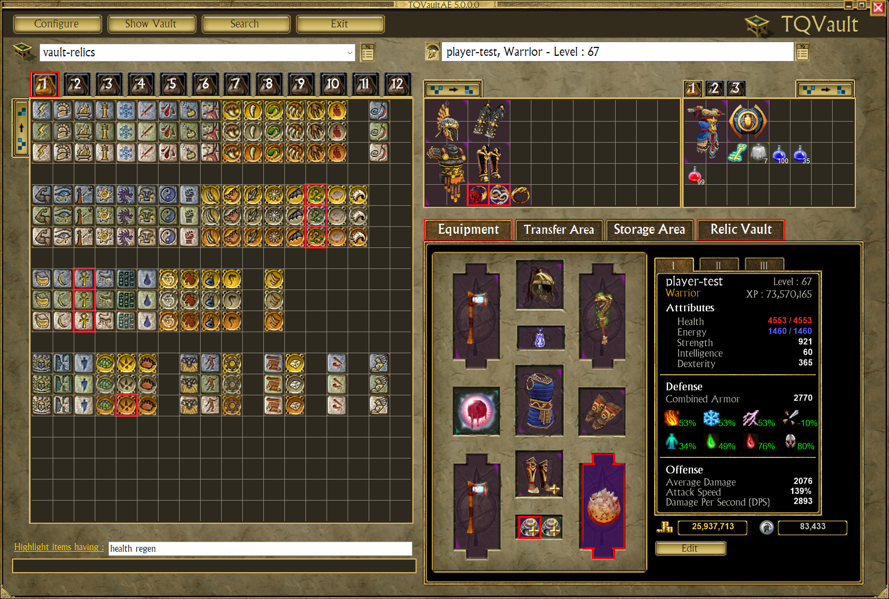
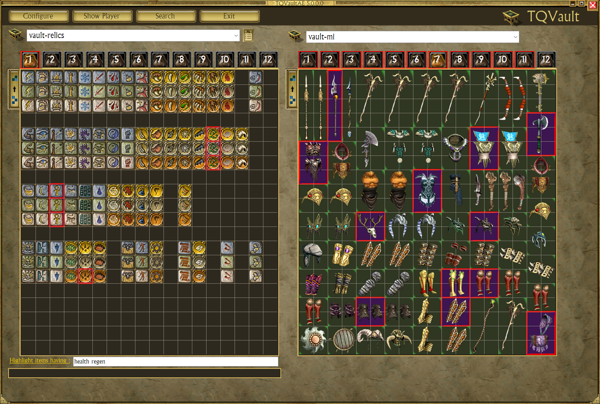
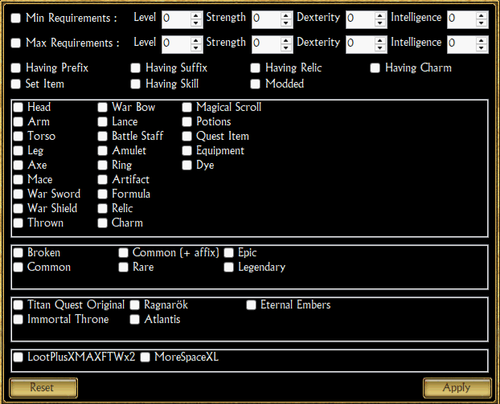
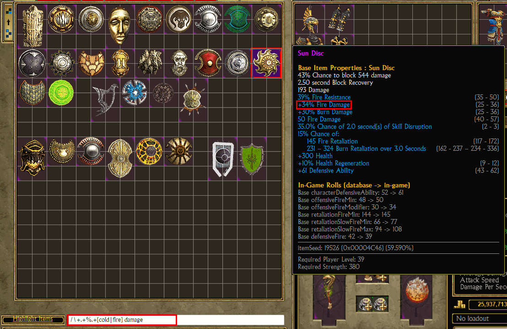

# Highlight system

As an addition to the integrated search engine, an highlight system let 
you find an item quickly directly from the main view.

Looking for "health regen" attribute?

## Vault and Player

## With secondary vault

## Extended filters

You may need to refine your search further.

This popup appear by clicking the label *"Highlight items having"*.

You can create a "requirement range" via Min/Max checkboxes.

_**Note:** Leaving a value to 0 means "ignore"._

The popup also has check boxes (Having Prefix, Having Suffix, Having Relic, Having Charm, Set Item, Having Skill, Modded)
and lists to tick: item types, rarity, origin and, when mods are installed, the installed mods. The screenshot below is
older and shows only the first two boxes.

*Modded* keeps the items that come from a mod, installed or not: the mod of the item itself, or the mod of the vault or
character holding it ([mod links](MODLINK.md)). Ticking mods in the mod list keeps only the items of those mods.

Inside a list, the ticked entries add up (an item of any of them matches); the boxes, the requirement range and the lists
must all match.

<kbd>CTRL</kbd>+<kbd>S</kbd> selects all the highlighted items of the bag under the mouse.

## Regular expression

By using `/` as first char everything else is a standard [C# regular expression](https://docs.microsoft.com/en-us/dotnet/standard/base-types/regular-expression-language-quick-reference).

Here's few examples.

- `/rune|earth` : Everything with "rune" or "earth"
- `/chance of .+%.+bleeding damage` : All chance of + percent bleeding damage
- `/\+.+%.+(life|mana) leech` : Any + percentage of life or mana leech
- `/\+.+%.+(cold|fire) damage` : Any + percentage of cold or fire damage

