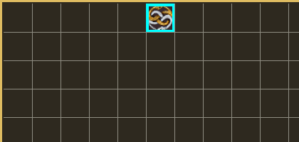
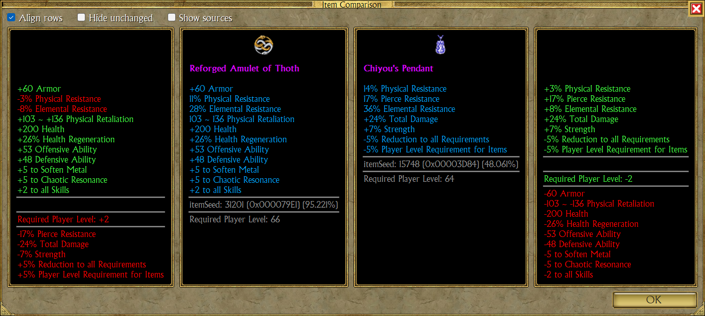
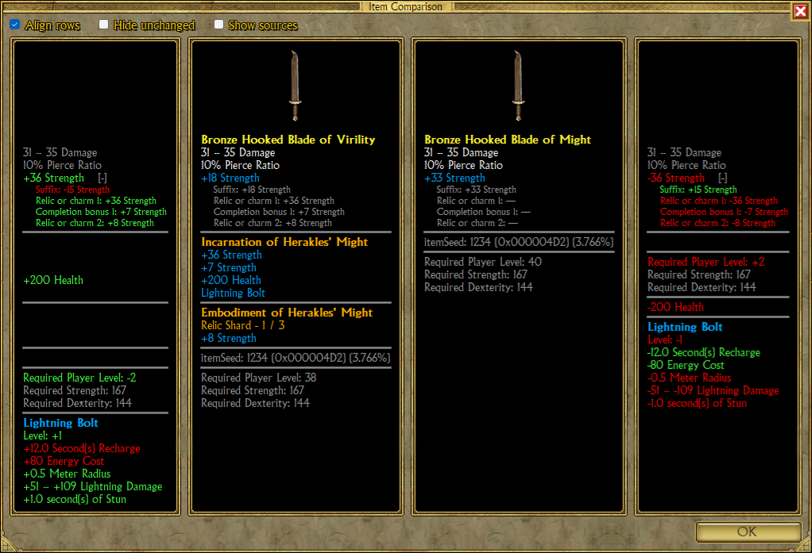
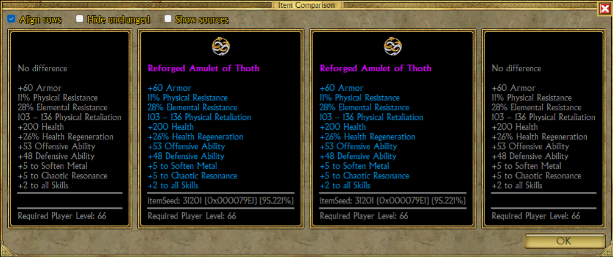
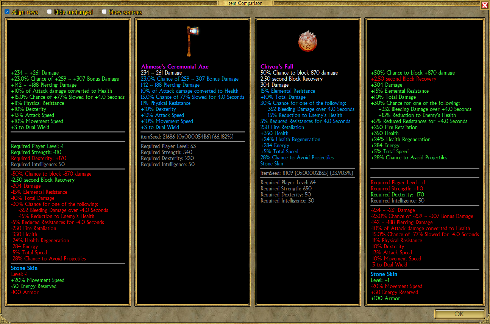
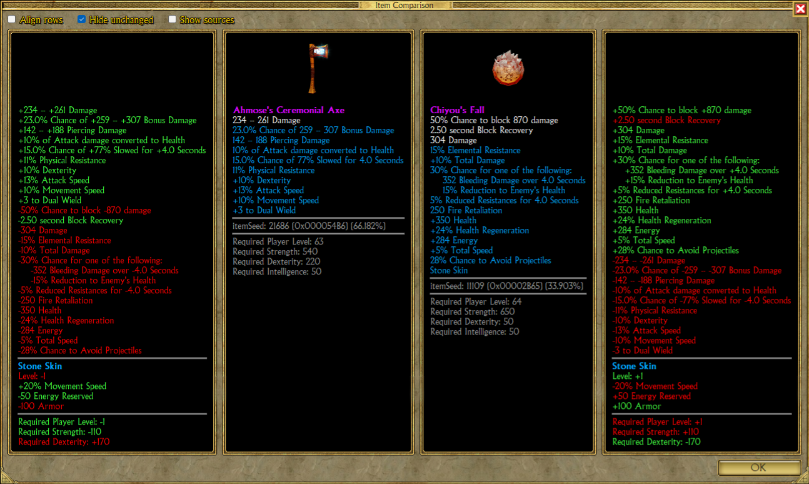
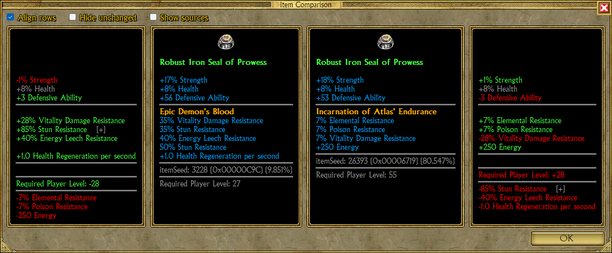
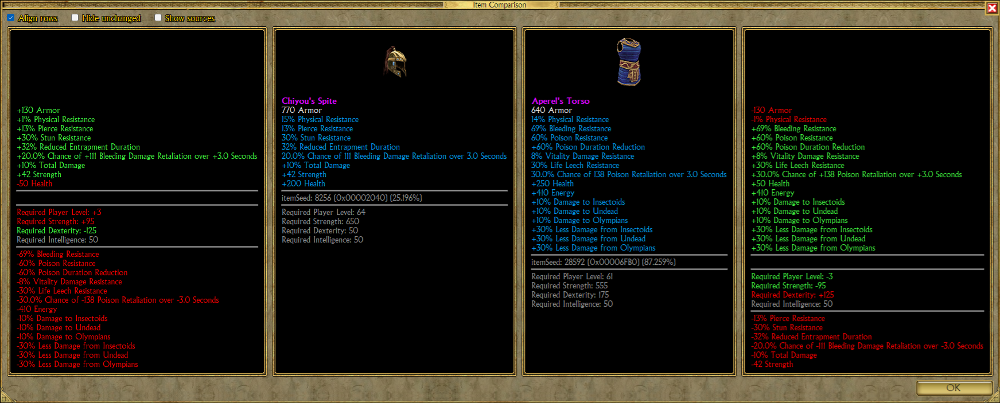
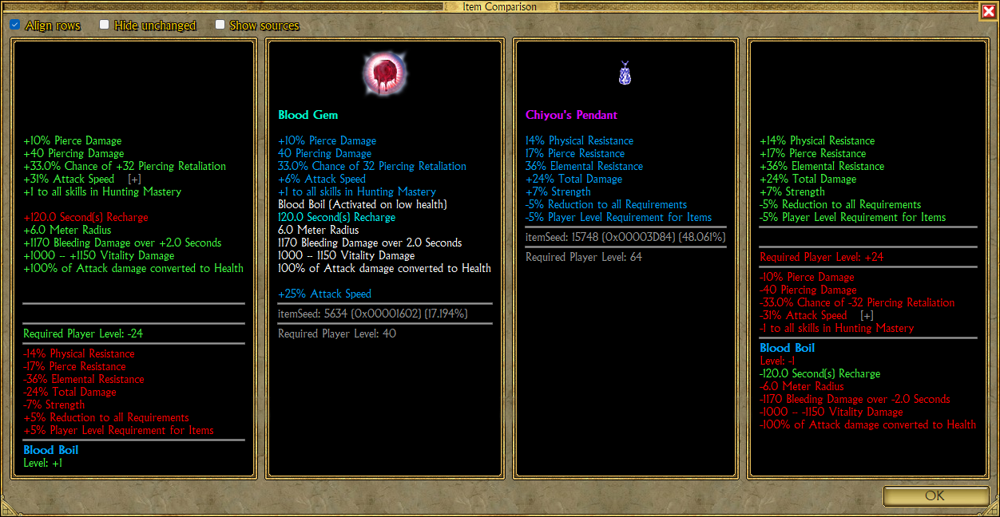

# Item comparison

Compare two items stat by stat. They can be anywhere: vault, secondary vault, player bags, equipment, stashes, two
different vaults.

## Open it

1. Right-click the first item > **Compare**. It gets an aqua frame, the cursor becomes a hand, the status line says
   what to do.
2. Left-click the second item, in any panel. The click opens the comparison instead of taking the item.

- While waiting, you can switch bags, vaults or characters.
- <kbd>Esc</kbd>, a right-click or a left-click on the first item cancels; a click on an empty cell does nothing.

Each comparison opens in its own window beside the main window:

- Several can stay open, each a step down and right of the previous one; the main window stays usable.
- It shows the two items as they were when it opened: later moves, changes or deletions do not change it.
- It follows the main window's zoom and closes with it.

## Layout

A toolbar, then four columns:

| Column | Shows |
|---|---|
| Diff 1 | Item 1 minus item 2 |
| Item 1 | Picture and tooltip of the first item, lines with a number only |
| Item 2 | Picture and tooltip of the second item, lines with a number only |
| Diff 2 | Item 2 minus item 1 |

Toolbar check boxes:

- **Align rows**: each difference sits on the row of the item line showing that stat, a granted skill's effects under
  the skill's name. Below a line follow the stats only the other item has and those the tooltip does not list (the
  effects of a skill the tooltip only names). Unchecked: differences listed one after the other, grouped.
- **Hide unchanged**: leaves out the stats both items have with the same numbers.
- **Show sources**: opens the sources of every stat that has some ([Sources of a stat](#sources-of-a-stat)).

Saved in `UserConfig.xml` at each change: `<ItemCompare AlignRows="1" HideUnchanged="0" ShowSources="0" />` (1 on,
0 off). Default: rows aligned, unchanged stats shown, sources closed.

## Sources of a stat

A total can come from several sources: base item, prefix, suffix, the relic or charm of each slot, each completion
bonus. The same total can be made of different parts, e.g. 20% base + 15% removable relic against 35% base alone.

- A stat with more than one source, on either item, ends with `[+]` in the difference columns.
- Click the stat (its difference or its item line) to open one line per source under it; `[-]` closes them.
- **Show sources** opens them all; a click then closes one.

- Sources are matched by role: base with base, first relic slot with first relic slot.
- Source lines, in a smaller font, show:
  - in the item column, what that source gives on this item (`—` when the item has no such source);
  - in the difference column, the difference with the same source of the other item (a missing source counts 0).

  Colors follow the rules of the totals.
- Rows not aligned: the source lines come under the stat's difference only.
- The totals do not change: closed, a stat shows exactly what it shows without sources.
- With **Hide unchanged**, a stat with the same total still shows while its sources are open and differ.

## Reading the differences

- Values are the displayed ones: **Show In-Game Values** applies.
- On both items: the difference (`+12 Strength`).
- On one item only: in full, plus on its side, minus on the other.
- Same numbers on both: as the item writes it, in gray.
- Only lines with a number are compared and shown, in the item columns too: lore, set member lists, `Speed: Fast` or
  `Grants Skill :` are left out. Kept: the item name, warnings, granted skill names, and a text heading indented lines
  with numbers (`Bonus to all Pets:`).
- Relics, charms and completion bonuses add to the item's own stats; their parts show under the total on demand
  ([Sources of a stat](#sources-of-a-stat)).
- Granted skills are compared in their own group; requirements come last.

| Color | Meaning |
|---|---|
| Green | Better for this column's item |
| Red | Worse |
| Yellow | Mixed (some numbers up, some down) |
| Gray | Unchanged |

Lower is better, so colors are reversed, for the requirements and for:

- energy cost, active energy cost, life cost, recharge time, energy reserved, shield block recovery;
- reductions written with a minus sign: `-10% Recharge`, `-10% Energy Cost`,
  `-15% Strength Requirement for all Weapons`, `-5% Reduction to all Requirements`, shield recovery time.

The list is kept by game attribute name in `LowerIsBetterStats`, matched with the labels of the current language.

No difference at all: "No difference" on top.

## Examples

Weapon against a shield granting a skill (aligned):

The same, rows not aligned, unchanged stats hidden:

Rings with a charm vs a relic:

Different slots, mostly different stats:

Artifact with a granted skill and completion bonus vs an amulet:

## Limits

- The classic tooltip names a granted skill without its effects: with **Align rows**, the skill's differences come
  after the item's lines.
- A stat only one item has is colored by the sign of its numbers: a block recovery time only a shield has shows red on
  the shield's side.
- Sources split only the item's attributes: a granted skill's effects and the requirements have none.
