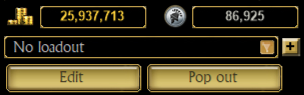
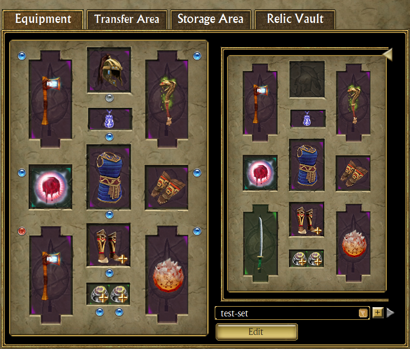
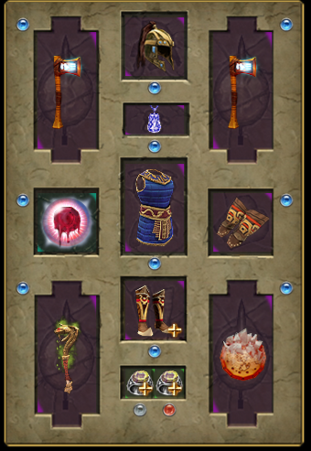

# Loadouts

A loadout is a saved equipment set of a character: the pieces it wears, slot by slot, both weapon sets, and which
weapon set is in hand. Save the gear you wear for one build, wear another, and come back to the first one in a click.

## Where

On the **Equipment** tab, under the gold of the character statistics, the whole width of the statistics (the **Edit**
button of the character editor, when it shows, is on the line below):

- The box lists the character's loadouts: click it to choose one.
- **[+]** records the gear worn now as a new loadout. TQVault asks a name, as for **Duplicate Character**; two loadouts
  of a character cannot have the same name (case is ignored).
- The gold arrow (**Load**) wears the loadout chosen in the box; it is grey when there is nothing to load, the
  character is read-only, or the setting **Player Equipment ReadOnly** is on (its tool tip then says so; the other
  actions stay).
- A right click on the bar gives every action: **Load**, **Update with the gear worn now** (asks first), **Rename**,
  **Copy** (the same pieces under another name), **Delete** (asks first) and **Add**.

## Composing a loadout

Choose a loadout in the box: it shows as a second equipment panel in place of the character statistics, with the same
slots as the equipment, both weapon sets included, and the loadout's pieces in them. Compose it by drag and drop, as
the equipment:

- Drop a piece on a slot: it **moves** into the loadout and leaves where it came from (a vault, a bag, the stash, the
  equipment). To keep the piece where it is, make a copy first (item menu **Copy Item** or **Duplicate Item**) and
  drop the copy.
- Pick a piece up from a slot: it goes to the hand, like any drag; drop it in a vault, a bag, the equipment or another
  slot. The piece under a drop goes to the hand too.
- The rules of the equipment apply: each slot takes its kind of item, a two-handed weapon takes both hands of its weapon
  set, and with the setting **Enable Item Requirement Restriction** a piece the character cannot use yet is refused.
- The item menu works on the pieces (properties, compare, search, copy, edit when allowed), except **Move Item To**.
- The comparison marks stay beside the equipment slots: they follow the pieces you move.
- The small gold arrow in the upper right corner of the panel (**Back to the statistics**) shows the statistics again.
  The loadout stays chosen in the box; choose it (or another one) to show the panel again.

The changes are kept until you save, as for the other files: the **Save** button, or the save when TQVault closes. Any
action of the bar that writes the loadouts file (add, update, rename, copy, delete) writes the loadouts as they are
then, the composed pieces included. **Update with the gear worn now** replaces the chosen loadout's pieces with copies
of the worn gear: the pieces you had moved into it are gone with it, as with **Delete**, so take them out first.

A read-only character, or the setting **Player Equipment ReadOnly**, does not keep you from composing its loadouts: the
loadouts file is apart from the character's save.

## Comparing with the chosen loadout

While a loadout is chosen in the box, a small button beside each equipment slot tells how the piece you wear there
compares with the loadout's piece for the same slot:

- **Blue**: the same piece (exactly, as **Load** sees it: same item, affixes, relics or charms, seed). Load keeps it.
- **Red**: two different pieces. Rings or weapon sets worn the other way round count as different here: the marks
  compare slot by slot.
- **Grey**: one side is empty (nothing worn, or nothing in the loadout for that slot).
- No mark when both are empty.

Click a blue or red mark to open the [item comparison](ITEMCOMPARE.md) of the worn piece (first) and the loadout's
(second). A grey mark does nothing: there is only one piece.

Rest the pointer on a mark to read its state in a tool tip: the same as, different from, empty in or not worn
against the loadout chosen (named), then "Click to compare" on a blue or red mark.

The marks sit in the gaps around the slots: beside the weapon, shield, arms and artifact slots, under the others. They
follow any change of the gear (a piece moved, Load, Update) and of the choice in the box, and show neither for a
read-only character nor when no loadout is chosen. An item you hold counts as out of its slot.

## What Load does

- A piece you wear that is **exactly** the loadout's (same item, same affixes, same relics or charms with the same
  bonus and pieces, same seed) stays on you. Worn in another slot (rings swapped, weapon sets swapped), it just moves to
  its slot.
- The other loadout pieces are put on as copies of the saved ones.
- The pieces you wear that the loadout does not use are taken off and stored in the **vault bag shown** in the vault
  panel. Only these pieces need room. Without room for all of them, nothing changes and the status line says so: show
  another bag, or make room, and load again.
- With the setting **Replace the worn pieces instead of storing them in the vault** (Settings, group **Loadouts**),
  these pieces are deleted instead: no vault is needed. Since a loadout keeps copies, this saves piling up duplicates.
  TQVault lists the pieces and asks first, unless **Bypass Confirmation Messages** is on.
- The loadout's weapon set is put in hand.
- No requirement is checked: like the game, a piece you cannot use yet stays in its slot without its bonuses.
- Save as usual to write the character and the vault.

A loadout keeps **copies**: an item has nothing that tells it apart from an identical copy, so a loadout does not point
to "your" sword in a vault. Load a loadout while its sword lies in a vault and you get a second sword; take the one in
the vault instead when you want only one.

## Good to know

- The game keeps the character it plays in memory and writes over the save: TQVault asks before **Load** and **Update**
  while the game runs. Change a character only while the game does not play it.
- A **read-only** character lists its loadouts and they can be composed in the loadout panel; the other actions are
  refused.
- Modded characters: the pieces are read with the character's mod, like its other items. A piece moved into a loadout
  takes the character's mod (a slot holds any size); taken out into a bag of another mod, it takes that bag's mod, as
  any drop (see [mod links](MODLINK.md)).
- The loadouts are in the [search](ADVANCEDSEARCH.md): a result says the character and the loadout (type *Loadout*);
  clicking it shows the character's equipment with that loadout chosen, in the loadout panel.
- The loadouts are kept in `TQVaultAE.Loadouts.json` in the character's save folder (`SaveData\Main\_<name>` or
  `SaveData\User\_<name>`), next to `Player.chr`. They follow the character when it is archived, duplicated by
  TQVault (**Duplicate Character**) or backed up with the [Git backup](GITBACKUP.md).
- Steam Cloud does not carry this file: the game's Steam Cloud settings sync its own save files by file type, and a
  `.json` file is not one of them (checked on a Steam install: the character's save files were synced after the TQVault
  files were written, the TQVault files were not). Steam leaves the file alone; it simply stays on the computer where
  the loadouts were made. To have them on another computer, use the [Git backup](GITBACKUP.md).
