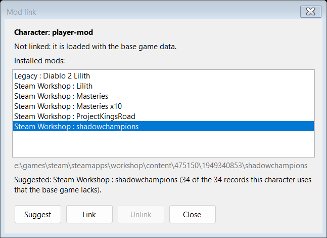
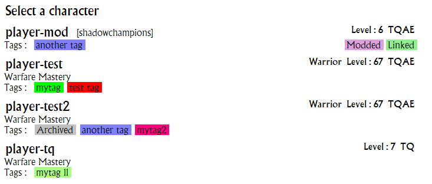
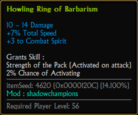
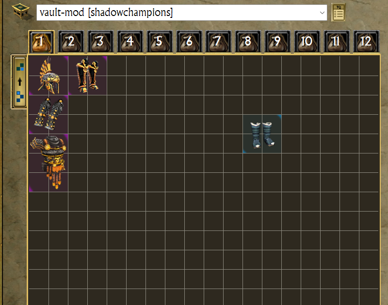

# Mods (custom maps)

TQVaultAE shows modded characters, vaults and items with their mod's data, next to regular ones, in one session.
Technical details: [MODLINK.md](MODLINK.md).

* [Link a character](#LinkCharacter)
* [Incomplete items](#Incomplete)
* [The mod of an item](#ItemMod)
* [Link a vault](#VaultLink)
* [Larger inventories and caravans](#Inventory)
* [Rules](#Rules)

---

### Link a character
Character menu > **Mod link...** (a custom map character, or a main campaign one played with a bounce mod):

- **Suggest** picks the installed mod that has the character's unknown records.
- **Link** (or double click a mod) saves the choice; **Unlink** removes it.

The character list shows the mod and the link state: **Linked**, **Not linked** or **Not installed**. A linked
character's class and masteries are named with its mod's data, as in the game.

A main campaign character linked to a mod (a **bounce mod**, badge *Bounce mod*) is read with the mod's data, but its
Transfer Stash and Relic Vault stay the main campaign's (`SaveData\Sys`). These are read with the shown character's
mod: a bounce mod's item there shows incomplete while a base game character is shown. Details:
[Bounce mods](MODLINK.md#bounce-mods).

---

### Incomplete items
An item whose records the loaded data lacks says so in its tooltip; without its base record, it shows as a warning tile.

---

### The mod of an item
- An item is read with the data of its container: its vault's link, its character's, or its shared stash's map (the
  mod's data, then the base game's), whatever character is shown. The main campaign's shared stashes take the shown
  character's mod (bounce mods).
- Its tooltip names its mod: the mod whose data gave at least one of its records.
- An item has no link of its own, and none is saved. In a container of another mod, or of the base game, it is read
  with that data, and may lose its mod and show as incomplete.

**Keep mod items in a vault linked to their mod.**

---

### Link a vault
Vault tools button > **Modded vault**. The vault list shows the mod; the vault's items use its data.

---

### Larger inventories and caravans
For mods that change the space (e.g. [More Space](https://www.nexusmods.com/titanquestanniversaryedition/mods/92)):

- Inventory and bags: the sizes of the character's map (`UICharWindowInventorySack0Dims*` and `Sack1Dims*` of
  `records\xpack\game\gameengine.dbr`, 32 pixels a cell): 20 x 9 bags with More Space XL, 12 x 20 with XXL.
- A grid always holds the items its save keeps: items left beyond the mod's size stay reachable.
- No main inventory (both More Space variants): the bags take its room; items sent to the character go to the bag
  shown.
- Transfer area, storage area, relic vault: the size the shown character's mod sets (its `caravanwindow.dbr`, when it
  differs from the base game's: 20 x 20 with More Space XL), else the size saved in the stash file; never less than the
  file's size nor than its items cover. A shared stash (transfer, relic vault) follows the shown character's data.
- A stash file keeps its size when saved, grown only to hold an item put beyond it.
- A grid larger than its usual room scrolls (wheel, <kbd>SHIFT</kbd>+wheel across); the window keeps its size.

---

### Rules
- An item takes the data of its container (vault link, character link, or shared stash map). Its mod is the one its
  records come from, computed each time it is read.
- Nothing is guessed: an item comes from a mod only when that mod's data gave one of its records.
- An item read with another mod may take another size:
  - No longer fitting, it moves to a free spot of its tab.
  - Dropped by hand without room in the tab: refused, with a message (drop it in another tab).
  - Moved, imported, or in a vault whose link changed: it may go to another tab of the vault. Without any room, it is
    shown in one cell with a warning, and a message names it, until moved where its size fits.
- [Exports](IMPORT_EXPORT.md) keep the mod of the vault or tab, never an item's. An import drops a link to a mod that is
  not installed, and names it.
- A Steam Workshop mod and a custom map of the same folder name are two mods: the menus and the dialog show where each
  comes from.
