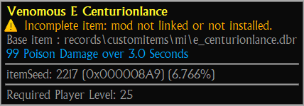
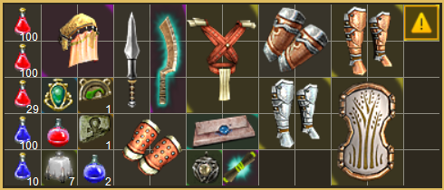
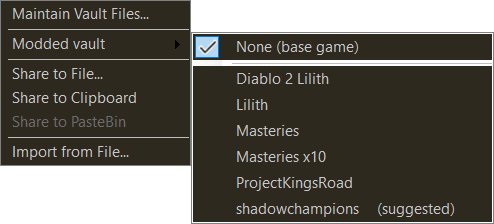

# Mods (custom maps)

TQVaultAE shows modded characters, vaults and their items with their mod's data, next to regular ones, in one session.
Technical details: [MODLINK.md](MODLINK.md).

* [Link a character](#LinkCharacter)
* [Incomplete items](#Incomplete)
* [The mod of an item](#ItemMod)
* [Link a vault](#VaultLink)
* [Rules](#Rules)

---

### Link a character
Character menu > **Mod link...**; the entry only shows for a character of a custom map. **Suggest** picks the installed
mod that has the character's unknown records; **Link** (or a double click on a mod) saves the choice, **Unlink** removes it.

The character list shows the mod and the link state: **Linked**, **Not linked** or **Not installed**. A linked
character's class and masteries are named with its mod's data, as the game names them.

---

### Incomplete items
An item whose records the loaded data lacks says so in its tooltip. Without its base record, it shows as a warning tile.

---

### The mod of an item
Every item is read with the data of its container: its vault's link, its character's, or its shared stash's map (a mod's
data, then the base game's), whatever character is shown. Its tooltip names its mod: the mod whose data gave at least
one of its records. An item has no link of its own, and none is saved: put in a container of another mod, or of the base
game, it is read with that data, and may lose its mod and show as incomplete. **Keep mod items in a vault linked to
their mod.**

---

### Link a vault
Vault tools button > **Modded vault**. The vault list shows the mod, and the vault's items use its data.

---

### Rules
- An item takes the data of its container: its vault's link, its character's, or its shared stash's map. Its mod is the
  one its records come from, computed each time it is read.
- Nothing is guessed: an item comes from a mod only when that mod's data gave one of its records.
- Read with another mod, an item that takes another size and no longer fits moves to a free spot of its tab. Dropped by
  hand without room in the tab, it is refused, and a message says it has no room in this tab: drop it in another tab.
  Moved, imported, or in a vault whose link changed, it may go to another tab of the vault; without any room, it is
  shown in one cell with a warning, until you move it where its size fits, and a message names it.
- [Exports](IMPORT_EXPORT.md) keep the mod of the vault or tab, never an item's. An import drops a link to a mod that is
  not installed and names it.
- A Steam Workshop mod and a custom map of the same folder name are two mods: the menus and the dialog show where each
  comes from.
